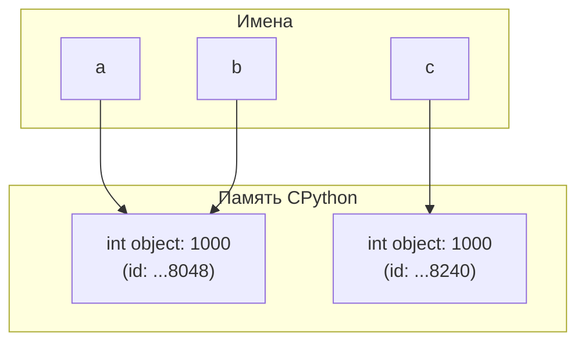

# Лабораторная работа № 1. Выполнение программы, объекты и базовые типы Python

**Студент:** Джунгуров Давид  
**Группа:** К3121  
**Направление:** 11.03.02 Инфокоммуникационные технологии и системы связи  
**Дисциплина:** Основы программирования  
**Дата:** 2026-09-20  

---

## 1. Задание 1. От исходного кода к байткоду

### Часть 1. Режимы запуска

**Сравнение REPL и запуска файла:**
- **REPL (Интерактивный режим):** При вводе выражения `2 + 3 * 4` интерпретатор автоматически вычисляет его значение и выводит представление объекта через `repr()` в стандартный вывод. Это происходит благодаря циклу REPL (Read-Eval-Print Loop).
- **Файловый режим (`task_1.py`):** В файловом режиме интерпретатор вычисляет значение выражения, но полученный результат не направляется в вывод и отбрасывается. Чтобы выдать результат на экран в файловом режиме, выражение необходимо передать в явную функцию вывода `print(2 + 3 * 4)`.

---

### Часть 2. Выражения и инструкции

В файле `task_1.py` использован следующий код:

```python
course = "Python"
hours = 4 * 2
print(f"{course}: {hours} часов")
```

**Анализ элементов программы:**

1. **Выражения (Expressions) — фрагменты кода, возвращающие значение:**
   - `"Python"` (строковый литерал, значение `"Python"`)
   - `4 * 2` (арифметическое выражение, значение `8`)
   - `4`, `2` (числовые литералы)
   - `course` (выражение доступа к переменной, значение `"Python"`)
   - `hours` (выражение доступа к переменной, значение `8`)
   - `f"{course}: {hours} часов"` (f-строка, значение `"Python: 8 часов"`)
   - `print(f"{course}: {hours} часов")` (вызов функции, значение `None`)

2. **Инструкции (Statements) — команды, выполняющие действие:**
   - `course = "Python"` (инструкция присваивания)
   - `hours = 4 * 2` (инструкция присваивания)
   - `print(f"{course}: {hours} часов")` (инструкция вызова функции / выражение-инструкция)

3. **Литералы (Literals):**
   - Строковый литерал: `"Python"`
   - Числовые литералы: `4`, `2`, `14` (в `2 + 3 * 4`)
   - Фрагменты f-строки: `": "`, `" часов"`

4. **Имена (Names/Identifiers):**
   - `course`
   - `hours`
   - `print` (встроенное имя функции)

---

### Часть 3. AST и байткод

**Версия интерпретатора:**
```text
Python 3.14.6
```

**Абстрактное синтаксическое дерево (AST):**
Выполнение `python3 -m ast task_1.py` дало следующую структуру узлов:

```text
Module(
   body=[
      Expr(value=Call(func=Name(id='print', ctx=Load()), args=[
         BinOp(left=Constant(value=2), op=Add(), right=BinOp(left=Constant(value=3), op=Mult(), right=Constant(value=4)))
      ])),
      Assign(targets=[Name(id='course', ctx=Store())], value=Constant(value='Python')),
      Assign(targets=[Name(id='hours', ctx=Store())], value=BinOp(left=Constant(value=4), op=Mult(), right=Constant(value=2))),
      Expr(value=Call(func=Name(id='print', ctx=Load()), args=[...]))
   ]
)
```

- **Присваивание:** Узлы `Assign(targets=[Name(id='course', ctx=Store())], value=Constant(value='Python'))`.
- **Арифметическая операция:** Узлы `BinOp(left=Constant(value=3), op=Mult(), right=Constant(value=4))` и `op=Add()`.
- **Вызов `print()`:** Узел `Call(func=Name(id='print', ctx=Load()), args=[...])`.

**Дизассемблированный байткод (`python3 -m dis task_1.py`):**

```text
  5           LOAD_NAME                1 (print)
              PUSH_NULL
              LOAD_SMALL_INT          14
              CALL                     1
              POP_TOP

  8           LOAD_CONST               1 ('Python')
              STORE_NAME               2 (course)

  9           LOAD_SMALL_INT           8
              STORE_NAME               3 (hours)
```

- **Загрузка константы:** Инструкции `LOAD_CONST` (для строкового литерала `'Python'`) и `LOAD_SMALL_INT` (для свёрнутых констант `14` и `8`).
- **Вызов функции:** Инструкция `CALL 1` для вызова `print()`.

> **Примечание по оптимизации (Constant Folding):** Выражения `2 + 3 * 4` и `4 * 2` были вычислены компилятором CPython на этапе свертки констант, в байткод попали сразу итоговые значения `14` и `8`.

---

### Контрольный вопрос 1

**Почему байткод CPython нельзя считать машинным кодом процессора?**

**Ответ:**  
Байткод CPython — это набор промежуточных инструкций для виртуальной машины (стекового автомата CPython), а не для физического процессора (x86, ARM и т.д.). Физический процессор не умеет напрямую выполнять байткод Python. Виртуальная машина CPython считывает байткод и выполняет соответствующие функции на C. В отличие от машинного кода, байткод платформонезависим и абстрагирован от архитектуры конкретного CPU.

---

## 2. Задание 2. Имена, объекты и сравнение

### Прогнозы и фактические результаты

```python
a = 1000
b = a
c = int("1000")
```

| Сравнение | Прогноз | Фактический результат | Объяснение |
| :--- | :--- | :--- | :--- |
| `a == b` | `True` | `True` | Значения объектов равны (1000 == 1000). |
| `a is b` | `True` | `True` | `b = a` связывает имя `b` с тем же самым объектом в памяти. |
| `a == c` | `True` | `True` | Значения объектов равны (1000 == 1000). |
| `a is c` | `False` | `False` | `int("1000")` создает новый объект числа 1000 вне диапазона кэшируемых малых целых. |

---

### Схема связей имен и объектов



---

### Разница между равенством значений (`==`) и идентичностью (`is`)

- **`==` (Value Equality):** Проверяет эквивалентность значений двух объектов путем вызова метода `__eq__`. Возвращает `True`, если данные в объектах одинаковы.
- **`is` (Identity):** Проверяет тождественность объектов — указывает ли два имени на один и тот же адрес в памяти (`id(x) == id(y)`).

---

### Изменение `c = None` и сравнение строк

При `c = None` проверка вывела:
`c is None: True`

Результат сравнения строк:
```python
first = "python"
second = "py" + "thon"

print(first == second) # True
print(first is second) # True
```
**Объяснение:** `first is second` дает `True`, так как CPython производит **интернирование строковых констант** (string interning) на этапе компиляции выражения `"py" + "thon"` в литерал `"python"`. Однотипные статические строки ссылаются на один синглтон-объект в таблице строк.

---

### Правило применения `==` и `is`

- **Используйте `is`:** Только при сравнении с синглтонами (`None`, `True`, `False`, `NotImplemented`) или для явной проверки тождества объекта в памяти.
- **Используйте `==`:** Во всех остальных случаях при сравнении значений (числа, строки, списки и другие структуры данных).

---

### Контрольные вопросы 2

1. **Создает ли инструкция `b = a` копию объекта?**  
   **Ответ:** Нет, инструкция `b = a` не создает копию объекта. Она создает новое имя `b` в текущей области видимости и связывает его со существующим объектом, на который указывает `a`.

2. **Что возвращают `type()` и `id()`?**  
   **Ответ:** `type(obj)` возвращает объект типа/класса, экзогенным образом определяющий поведение объекта. `id(obj)` возвращает уникальный целочисленный идентификатор объекта (в CPython это адрес объекта в оперативной памяти).

3. **Почему `None` принято сравнивать с помощью `is`, а числа и строки — с помощью `==`?**  
   **Ответ:** `None` — единственный синглтон-экземпляр класса `NoneType` в процессе Python. Сравнение `is None` проверяет равенство указателей в памяти, что работает за $O(1)$ и корректно защищено от переопределения оператора `==`. Числа и строки сравнивают через `==`, так как они могут находиться в разных точках памяти, имея при этом равные математические или текстовые значения.

---

## 3. Задание 3. Числовые типы, операции и преобразования

### Эксперимент A. `int` и арифметика

Результаты выполнения операций для `x = 17`, `y = 5`:

| Операция | Результат | Тип результата |
| :--- | :--- | :--- |
| `x + y` | `22` | `<class 'int'>` |
| `x - y` | `12` | `<class 'int'>` |
| `x * y` | `85` | `<class 'int'>` |
| `x / y` | `3.4` | `<class 'float'>` |
| `x // y` | `3` | `<class 'int'>` |
| `x % y` | `2` | `<class 'int'>` |
| `x ** y` | `1419857` | `<class 'int'>` |

**Объяснение `/` и `//`:**  
Оператор деления `/` по стандарту Python 3 (PEP 238) всегда возвращает значение типа `float` для обеспечения математической точности. Оператор `//` выполняет деление нацело (округление вниз до ближайшего целого) и сохраняет тип `int`, если оба операнда целые.

---

### Эксперимент B. Большие целые числа

```text
2 ** 1000 = 10715086071862673209484250490600018105614048117055336074437503883703510511249361224931983788156958581275946729175531468251871452856923140435984577574698574803934567774824230985421074605062371141877954182153046474983581941267398767559165543946077062914571196477686542167660429831652624386837205668069376
Тип: <class 'int'>
```

**Отличие от целых чисел с фиксированной разрядностью:**  
В языках C/C++ или Java целые типы (`int`, `long`) имеют фиксированный размер (32 или 64 бита) и вызывают переполнение (overflow) при выходе за пределы диапазона. В Python 3 тип `int` обладает **произвольной точностью** (arbitrary precision / длинная арифметика) — размер ограничен только доступной оперативной памятью компьютера.

---

### Эксперимент C. `float` и точность вычислений

- `0.1 + 0.2 = 0.30000000000000004`
- `result == 0.3: False`
- `result - 0.3 = 5.551115123125783e-17`
- `math.isclose(result, 0.3): True`

**Причина и правило безопасного сравнения:**  
Числа 0.1 и 0.2 не могут быть точно представлены в двоичной системе счисления с плавающей точкой IEEE 754 (получаются бесконечные двоичные периодические дроби). При их сложении возникает мелкая погрешность представления.  
**Правило:** Вещественные числа `float` нельзя сравнивать на прямое равенство оператором `==`. Их следует сравнивать с использованием `math.isclose(a, b)` или по относительному/абсолютному допуску `abs(a - b) < 1e-9`.

---

### Эксперимент D. Преобразование типов

| Выражение | Значение | Тип |
| :--- | :--- | :--- |
| `int("42")` | `42` | `<class 'int'>` |
| `float("3.14")` | `3.14` | `<class 'float'>` |
| `str(2026)` | `'2026'` | `<class 'str'>` |
| `bool(0)` | `False` | `<class 'bool'>` |
| `bool(-1)` | `True` | `<class 'bool'>` |
| `bool("")` | `False` | `<class 'bool'>` |
| `bool("False")` | `True` | `<class 'bool'>` |
| `complex(2, -3)` | `(2-3j)` | `<class 'complex'>` |

- **Комплексное число:** Действительная часть: `2.0`, Мнимая часть: `-3.0`.
- **Почему `bool("False")` равно `True`:** Функция `bool()` для строк проверяет не текстовый смысл слова, а длину строки. Любая непустая строка (`len(s) > 0`) является `truthy` (истинной).

---

### Контрольные вопросы 3

1. **Почему результат обычного деления двух объектов `int` имеет тип `float`?**  
   **Ответ:** Для исключения потерь дробной части при делении целых чисел и обеспечения точности математических расчетов.

2. **В чем отличие преобразования `int("42")` от `int(42.9)`?**  
   **Ответ:** `int("42")` выполняет синтаксический анализ (парсинг) текстовой строки с представлением числа, а `int(42.9)` выполняет усечение (отбрасывание) дробной части вещественного числа.

3. **Какие значения из эксперимента D являются falsy?**  
   **Ответ:** Falsy-значениями являются `bool(0)` и `bool("")`.

---

## 4. Задание 4. Строки, Unicode и форматирование

### Результаты работы `task_4.py`

1. **Символы имени:** Первый: `А`, Последний: `а`.
2. **Срезы:** Имя: `Анна`, Фамилия: `Смирнова`.
3. **Регистры:**
   - Upper: `АННА СМИРНОВА`
   - Lower: `анна смирнова`
4. **Инициалы:** `А.С.`
5. **Курс в обратном порядке:** `nohtyP ан яинавориммаргорп ывонсО`
6. **Строка результата (3 способа):**
   - Оператор `%`: `Анна Смирнова — Основы программирования на Python: 7/10 (70.0%)`
   - Метод `.format()`: `Анна Смирнова — Основы программирования на Python: 7/10 (70.0%)`
   - f-строка: `Анна Смирнова — Основы программирования на Python: 7/10 (70.0%)`
7. **Unicode исследования для символа `"Я"`:**
   - Кодовая позиция (`ord`): `1071` (0x042F)
   - Восстановленный символ (`chr`): `Я`
   - UTF-8 байты: `b'\xd0\xaf'`
   - Длина байтов UTF-8: `2`
8. **Попытка изменения символа:**
   - Код: `# student[0] = "О"`
   - Ошибка: `TypeError: 'str' object does not support item assignment`
   - Причина: Объект `str` в Python является неизменяемым (immutable).

---

### Контрольные вопросы 4

1. **Почему `len(symbol)` и `len(symbol.encode("utf-8"))` могут различаться?**  
   **Ответ:** `len(symbol)` возвращает количество Unicode кодовых точек (символов), а `len(symbol.encode("utf-8"))` возвращает количество байтов, требуемых для кодирования этого символа в кодировке UTF-8 (для кириллицы 1 символ занимает 2 байта).

2. **Что означают границы и шаг в записи `text[start:stop:step]`?**  
   **Ответ:** `start` — начальный индекс среза (включительно), `stop` — конечный индекс (исключительно), `step` — шаг и направление смещения при выборке элементов.

3. **Почему строка считается неизменяемым объектом, хотя методы вроде `.upper()` возвращают измененный текст?**  
   **Ответ:** Метод `.upper()` не модифицирует исходный объект строки в памяти, а выделяет память под совершенно новый объект типа `str` с преобразованными символами и возвращает ссылку на него.

---

## 5. Задание 5. Информационная карточка вычислительного эксперимента

### Вывод работы программы `task_5.py`

```text
========================================
ЭКСПЕРИМЕНТ: Проверка модели
Исследователь: Анна Смирнова
Запуски: 8
Общее время: 100.00 с (1.67 мин)
Коэффициент: (2-3j)
Квадрат модуля: 13.00
Есть выполненные запуски: True
========================================
Типы данных параметров: имя=str, эксперимент=str, запуски=int, длительность=float, re=float, im=float
```

---

### Анализ

1. **Типы имен переменным после выполнения:**
   - `researcher_name`: `str`
   - `exp_name`: `str`
   - `runs_count`: `int`
   - `run_duration`: `float`
   - `real_part`: `float`
   - `imag_part`: `float`
   - `total_duration_sec`: `float`
   - `total_duration_min`: `float`
   - `coeff`: `complex`
   - `sq_modulus`: `float`
   - `has_runs`: `bool`

2. **Разбор арифметической строки `total_duration_sec = runs_count * run_duration`:**
   - **Имя левой части:** `total_duration_sec` (целевое имя для связывания)
   - **Оператор присваивания:** `=`
   - **Оператор умножения:** `*`
   - **Имена правой части:** `runs_count` и `run_duration` (выражения доступа к значениям)

3. **Путь программы от кода к исполнению:**
   1. Исходный код `.py` считывается интерпретатором.
   2. Лексический и синтаксический анализ (парсер строит AST — дерево синтаксиса).
   3. Компиляция AST в промежуточный байткод CPython (инструкции `LOAD_`, `STORE_`, `CALL` и т.д.).
   4. Выполнение байткода виртуальной машиной CPython (главный цикл `PyEval_EvalFrameEx`).

4. **Почему результат `input()` необходимо явно преобразовывать?**  
   **Ответ:** Функция `input()` всегда возвращает текстовую строку `str`. Арифметические операции с текстом либо вызовут исключение `TypeError`, либо приведут к сцеплению строк (например, `"8" * 2` даст `"88"` вместо `16`).

---

### Контрольный вопрос 5

**Что в этой программе изменится на уровне объектов и связывания имен после повторного присваивания нового значения уже существующему имени?**

**Ответ:**  
Имя отвяжется от старого объекта и свяжется с новым объектом в памяти. Счетчик ссылок (reference count) старого объекта уменьшится на 1. Если на старый объект не останется других ссылок, сборщик мусора CPython (Garbage Collector) удалит его из памяти.

---

## 6. Краткий вывод

В ходе выполнения лабораторной работы были изучены основные принципы модели выполнения программ CPython, механика связывания имен, типы данных и операции над ними.

**Три наиболее неожиданные особенности Python:**
1. **Отсутствие копирования при присваивании `b = a`:** Присваивание создаёт лишь новую ссылку на тот же объект, а не дубликат данных в памяти.
2. **Погрешность представления `0.1 + 0.2`:** Особенности стандарта IEEE 754 требуют обязательного использования `math.isclose()` для безопасного сравнения чисел с плавающей точкой.
3. **Логическая истинность `bool("False")`:** Приведение строк к логическому типу зависит исключительно от длины строки, а не от ее значения, из-за чего строка `"False"` приводится к `True`.
