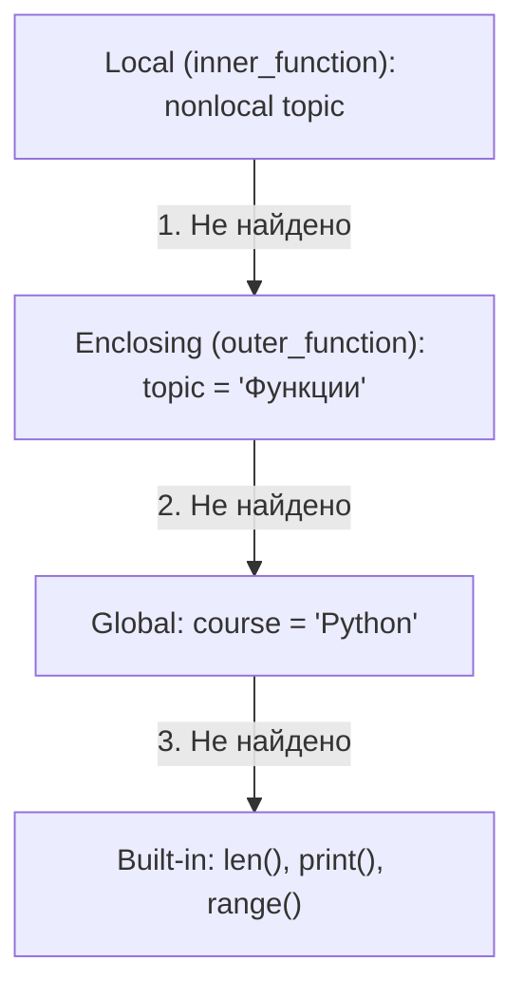

# Лабораторная работа № 3. Алгоритмы, коллекции и функции

**Студент:** Джунгуров Давид  
**Группа:** К3121  
**Направление:** 11.03.02  
**Дисциплина:** Основы программирования  
**Дата:** 2026-10-28  

---

## 1. Задание 1. Условия и классификация данных

### Описание решения (`task_1.py`)
- Проверяем диапазон входных данных: балл `score` от 0 до 100, число пропусков `absences` от 0 до 5. Если значение некорректно — выводим сообщение об ошибке и останавливаемся.
- Определение базового уровня:
  - 90–100: отличный
  - 75–89: хороший
  - 60–74: удовлетворительный
  - 0–59: недостаточный
- Если пропусков больше 3 (`absences > 3`), понижаем уровень на одну ступень:
  `отличный` $\rightarrow$ `хороший` $\rightarrow$ `удовлетворительный` $\rightarrow$ `недостаточный`.  
  Ниже уровня «недостаточный» оценка опуститься не может.
- Сопоставление типа работы через `match / case`: `exam` — экзаменационная работа, `project` — проектная работа, `practice` — практическая работа, `_` — неизвестный тип.

**Порядок проверки условий:**  
Проверяем от больших баллов к меньшим (`>= 90`, `>= 75`, `>= 60`, иначе недостаточный). Если бы проверяли снизу вверх (например, сразу `>= 60`), то для 80 и 95 баллов сработала бы первая ветка, а ветки `>= 75` и `>= 90` стали бы недостижимыми.

### Таблица тестовых сценариев Задания 1

| № | Балл | Пропуски | Тип работы | Ожидаемый результат | Фактический результат | Статус |
|:---:|:---:|:---:|:---:|:---|:---|:---:|
| 1 | 0 | 0 | practice | практическая работа, недостаточный | практическая работа, недостаточный | Успешно |
| 2 | 59 | 2 | practice | практическая работа, недостаточный | практическая работа, недостаточный | Успешно |
| 3 | 60 | 1 | project | проектная работа, удовлетворительный | проектная работа, удовлетворительный | Успешно |
| 4 | 74 | 3 | exam | экзаменационная работа, удовлетворительный | экзаменационная работа, удовлетворительный | Успешно |
| 5 | 75 | 0 | practice | практическая работа, хороший | практическая работа, хороший | Успешно |
| 6 | 89 | 2 | project | проектная работа, хороший | проектная работа, хороший | Успешно |
| 7 | 90 | 1 | exam | экзаменационная работа, отличный | экзаменационная работа, отличный | Успешно |
| 8 | 100 | 0 | project | проектная работа, отличный | проектная работа, отличный | Успешно |
| 9 | 90 | 4 | exam | экзаменационная работа, хороший (снижен) | экзаменационная работа, хороший | Успешно |
| 10 | 60 | 4 | practice | практическая работа, недостаточный (снижен) | практическая работа, недостаточный | Успешно |

---

## 2. Задание 2. Циклы и базовые алгоритмы

### Однопроходный анализ (`task_2.py`)
Исходный список: `measurements = [12, 15, 11, 18, 18, 9, 21, 15, 7, 18]`.  
Без использования встроенных `min()`, `max()`, `sum()` и `list.count()`:
- За один проход суммируем элементы, находим текущий минимум и максимум, считаем четные числа (`x % 2 == 0`).
- Считаем среднее арифметическое: `total / len(data) = 14.4`.
- Вторым проходом через генератор считаем числа строго больше среднего (получилось 6).

### Псевдокод алгоритмов

#### Псевдокод 1: Однопроходный анализ числового списка
```text
АЛГОРИТМ analyze_data(data):
    total = 0
    min_v = data[0]
    max_v = data[0]
    even_cnt = 0

    ДЛЯ x ИЗ data:
        total = total + x
        ЕСЛИ x < min_v ТО
            min_v = x
        ЕСЛИ x > max_v ТО
            max_v = x
        ЕСЛИ x MOD 2 == 0 ТО
            even_cnt = even_cnt + 1

    mean_v = total / ДЛИНА(data)
    above_mean_cnt = КОЛИЧЕСТВО(x ИЗ data ГДЕ x > mean_v)

    ВОЗВРАТ total, min_v, max_v, even_cnt, mean_v, above_mean_cnt
```

#### Псевдокод 2: Бинарный поиск в отсортированном списке
```text
АЛГОРИТМ binary_search(data, target):
    left = 0
    right = ДЛИНА(data) - 1
    comps = 0

    ПОКА left <= right:
        comps = comps + 1
        mid = (left + right) DIV 2
        ЕСЛИ data[mid] == target ТО
            ВОЗВРАТ mid, comps
        ИНАЧЕ ЕСЛИ data[mid] < target ТО
            left = mid + 1
        ИНАЧЕ
            right = mid - 1

    ВОЗВРАТ -1, comps
```

### Оценки временной и пространственной сложности

| Алгоритм | Время (лучшее) | Время (худшее / среднее) | Память | От чего зависит число операций |
|:---|:---:|:---:|:---:|:---|
| **Однопроходный анализ** | $O(N)$ | $O(N)$ | $O(1)$ | Зависит от длины списка $N$. Требует два последовательных прохода. |
| **Линейный поиск** | $O(1)$ | $O(N)$ | $O(1)$ | Зависит от позиции элемента. Худший случай — элемента нет в списке ($N$ сравнений). |
| **Проверка простоты** | $O(1)$ | $O(\sqrt{n})$ | $O(1)$ | Зависит от величины числа $n$. Худший случай — $n$ простое число. |
| **Сортировка выбором** | $O(N^2)$ | $O(N^2)$ | $O(1)$ | Всегда делает $\frac{N(N-1)}{2}$ сравнений независимо от исходного порядка. |
| **Бинарный поиск** | $O(1)$ | $O(\log_2 N)$ | $O(1)$ | На каждом шаге диапазон поиска делится пополам. |

**Обоснование перебора делителей до $\sqrt{n}$:**  
Если число $n$ составное, его можно разложить на множители: $n = a \cdot b$. Если бы оба сомножителя были строго больше $\sqrt{n}$, то $a \cdot b > \sqrt{n} \cdot \sqrt{n} = n$, то есть $n > n$ — противоречие. Значит, хотя бы один делитель составного числа обязан быть $\le \sqrt{n}$. Если до $\sqrt{n}$ делителей не найдено, число гарантированно простое.

### Сравнительная таблица числа сравнений

Эксперимент на списках из 10, 100 и 1000 элементов:

| N | Элемент | Линейный поиск (сравнений) | Бинарный поиск (сравнений) |
|:---:|:---|:---:|:---:|
| 10 | Первый | 1 | 3 |
| 10 | Середина | 6 | 3 |
| 10 | Последний | 10 | 4 |
| 10 | Нет в списке | 10 | 3 |
| 100 | Середина | 51 | 6 |
| 100 | Последний | 100 | 7 |
| 1000 | Середина | 501 | 9 |
| 1000 | Последний | 1000 | 10 |

---

## 3. Задание 3. Коллекции и выбор структуры данных

### Обоснование выбора коллекций

1. **Почему `set` подходит для хранения уникальных значений:**  
   Множество устроено на базе динамической хеш-таблицы. При добавлении элемента вычисляется `hash(element)`. Если такой элемент уже есть, дубликат не добавляется. Поиск (`in`) и добавление происходят за среднее время $O(1)$, что обеспечивает поддержание уникальности без дополнительных проверок.
2. **Почему кортеж (`tuple`) можно использовать как ключ словаря:**  
   Ключом словаря в Python может быть только неизменяемый (`immutable`) объект, для которого определен устойчивый хеш (`__hash__`). Кортеж `(student, lab)` неизменяем, поэтому его хеш постоянен на всем протяжении работы программы.
3. **Почему список (`list`) НЕЛЬЗЯ использовать как ключ словаря:**  
   Список — изменяемый тип данных (`mutable`). Если бы список был ключом словаря, его изменение (например, `append`) изменило бы хеш, и элемент потерялся бы в хеш-таблице. Поэтому для списков метод `__hash__` не определен и Python генерирует ошибку `TypeError: unhashable type: 'list'`.
4. **Почему словарь (`dict`) предпочтительнее списка для поиска по ключу `(student, lab)`:**  
   В списке для поиска нужной пары требуется полный перебор элементов от начала до конца со сложностью $O(N)$. Словарь находит значение по хешу ключа за $O(1)$ в среднем.

Студенты, сдававшие обе работы (`lab_01` и `lab_02`): определены через проверку вхождения множества работ каждого студента. Обе работы сдали `anna` и `boris`.

---

## 4. Задание 4. Функции, параметры и области видимости

### Схема областей видимости LEGB

В Python поиск переменных происходит по цепочке **LEGB**:
1. **L**ocal (локальная область внутри текущей функции);
2. **E**nclosing (область объемлющей внешней функции);
3. **G**lobal (глобальная область файла модуля);
4. **B**uilt-in (встроенные функции и константы Python: `len`, `print`, `range` и др.).



В коде `task_4.py`:
- Переменная `course` объявлена глобально.
- Переменная `topic` создана во внешней функции `outer_function()`.
- Во вложенной функции `inner_function()` инструкция `nonlocal topic` позволяет изменить переменную внешней функции, не создавая локальной переменной и не трогая глобальную `course`.

### Ошибка изменяемого значения по умолчанию (`results=[]`)
Значение аргумента по умолчанию вычисляется один раз при чтении инструкции `def`. Список создается в памяти один раз и привязывается к атрибуту функции `__defaults__`. При повторных вызовах `add_result(1)` и `add_result(2)` без второго параметра используется один и тот же список, поэтому данные накапливаются между вызовами.  
**Исправление:** использовать `results=None`, а внутри функции создавать новый список: `if results is None: results = []`.

---

## 5. Задание 5. Анализатор учебных результатов (Интеграционное задание)

### Контракты функций интеграционного задания

1. **`mean(values: list[float | int]) -> float`**
   - *Вход:* список чисел. Входной список не изменяется.
   - *Выход:* среднее арифметическое (`float`).
   - *Особый случай:* если передан пустой список `[]`, возвращает `0.0` (ранний возврат).
2. **`minimum(values: list[float | int]) -> Optional[float | int]`**
   - *Вход:* список чисел. Реализован без использования встроенной функции `min()`.
   - *Выход:* наименьшее значение в списке.
   - *Особый случай:* если список пуст, возвращает `None`.
3. **`maximum(values: list[float | int]) -> Optional[float | int]`**
   - *Вход:* список чисел. Реализован без использования встроенной функции `max()`.
   - *Выход:* наибольшее значение в списке.
   - *Особый случай:* если список пуст, возвращает `None`.
4. **`classify(score: float | int) -> str`**
   - *Вход:* числовой балл от 0 до 100.
   - *Выход:* текстовая категория: `'отличный'` ($\ge 90$), `'хороший'` ($75..89$), `'удовлетворительный'` ($60..74$), `'недостаточный'` ($< 60$).
5. **`student_summary(name: str, results: list[int]) -> dict[str, Any]`**
   - *Вход:* строка с именем студента и список его оценок.
   - *Выход:* словарь со статистикой студента (`name`, `results`, `mean`, `min`, `max`, `category`).
   - *Особый случай:* для студента без оценок (`results == []`) возвращает `mean: 0.0`, `min: None`, `max: None`, `category: 'нет оценок'`.
6. **`find_top_students(students: dict[str, list[int]]) -> list[tuple[str, float]]`**
   - *Вход:* словарь группы `имя -> список оценок`.
   - *Выход:* список пар `(имя, средний_балл)` для студентов с наибольшим средним. При равенстве баллов возвращает всех лидеров. Для пустой группы возвращает `[]`.
7. **`group_summary(students: dict[str, list[int]]) -> dict[str, Any]`**
   - *Вход:* словарь студентов группы. Исходный словарь **не изменяется**.
   - *Выход:* словарь общей статистики: индивидуальные карточки, средний балл группы, подсчет по категориям, список лидеров и отсортированный рейтинг.
8. **`format_report(student_data: dict[str, dict], group_data: dict) -> str`**
   - *Вход:* сформированные словари данных по студентам и по группе.
   - *Выход:* отформатированная строка для вывода таблицы на экран.

### Таблица тестовых сценариев Задания 5

| № | Сценарий | Входные данные | Ожидаемый результат | Фактический результат |
|:---:|:---|:---|:---|:---|
| 1 | Базовый набор | 4 студента (Анна, Борис, Дарья, Илья) | Ср. балл 79.38, лидер: Дарья (93.75) | Ср. балл 79.38, лидер: Дарья (93.75) |
| 2 | Один студент | Виктор: [85, 90, 88] | Ср. балл 87.67, лидер: Виктор | Ср. балл 87.67, лидер: Виктор |
| 3 | Несколько лидеров | Алиса: [90, 100], Максим: [92, 98] (оба по 95.0) | Лидеры: Алиса (95.00), Максим (95.00) | Лидеры: Алиса (95.00), Максим (95.00) |
| 4 | Пустая группа | `{}` | Ср. балл 0.00, лидеры: нет данных | Ср. балл 0.00, лидеры: нет данных |
| 5 | Студент без оценок | Елена: [90, 95], Николай: [] | Николай: 'нет оценок', в конце рейтинга | Николай: 'нет оценок', в конце рейтинга |
| 6 | Граничные значения | 59, 60, 74, 75, 89, 90 | Точное совпадение с категориями | Точное совпадение с категориями |

---

## 6. Вывод о том, как декомпозиция повлияла на читаемость решения

Разбиение интеграционной задачи на отдельные небольшие функции существенно улучшило программу:
1. **Разделение ответственности:** математические функции (`mean`, `minimum`, `maximum`) занимаются только вычислениями, функция `classify` отвечает за шкалу, `student_summary` собирает структуру данных, а `format_report` отвечает исключительно за красивый вывод на экран.
2. **Простота отладки и тестирования:** каждую функцию можно вызывать и проверять независимо. Например, расчет среднего или граничные баллы проверены отдельно от логики составления рейтинга.
3. **Безопасность и устойчивость:** благодаря декомпозиции и четким контрактам краевые случаи (пустая группа или студент без оценок) обрабатываются локально без падения всей программы.
4. **Неизменяемость данных:** исходные словари и списки не мутируют в процессе работы функций, что исключает побочные эффекты.
